# User vs Daemon thread
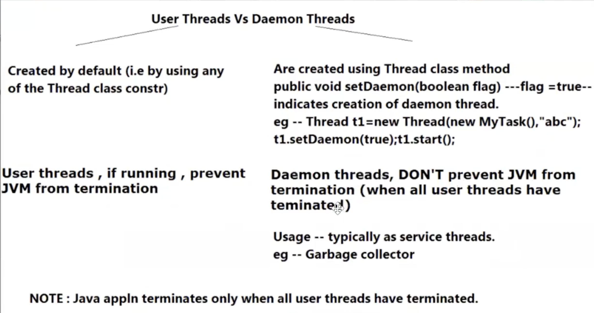

```java
package daemon_thrds;
public class RunnableTask implements Runnable{
    @Override
    public void run(){
        System.out.println(Thread.currentThread().getName + " started");
        try{
            for(int i = 0; i < 10; i++){
                if(Thread.currentThread().getName().equals("two")){
                    System.out.println("Enter Data");
                    int data = System.in.read();
                }
                System.out.println(Thread.currentThread().getName() + " exec # " + i);
                Thread.sleep(500);
            }
        } catch(Exception e){
            System.out.println("err in thrd " + Thread.currentThread().getName() + " exc " + e);
        }
    }
}
```

```java
package daemon_thrds;
public class Tester{
    public static void main(String[] args) throws InterruptedException{
        System.out.println("main thrd's details" + Thread.currentThread());

    }
}
```

Web_programming pre-requisites
DB related instructions
jdbc-whiteboard
sequnce
jdbc drivers


JDBC : Java DB Connectivity
What is it? : API -- java.sql -- to allow prog -- to connect to DB, CRUD, close connection
why? : allows prog: platform independence DB apps + DB vendor independence.
JDBC allows only partial DB independence.
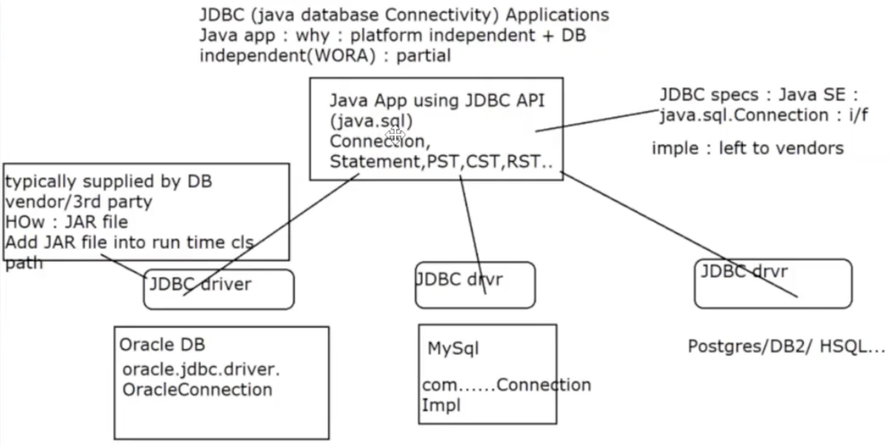
JDBC -> Java to db language and DB lang to Java translator
JDBC Driver is DB specific
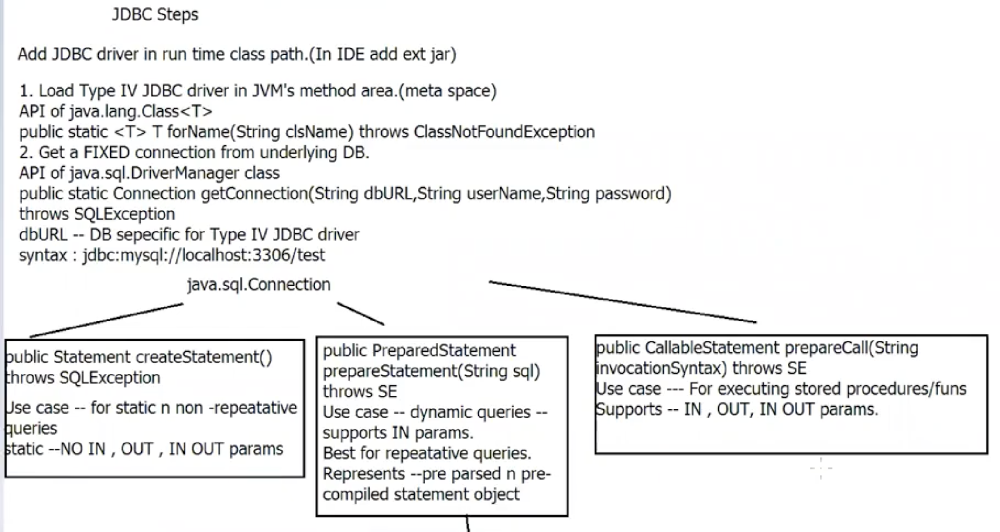
```java
package tester;
public class TestDBConnection{
    public static void main(String[] args){
        try{
        //Class.forName("com.mysql.cj.jdbc.Driver"); --> Only needed in older versions of jdbc-> loading connector
        String url = "jdbc:mysql://localhost:3306/dac22?useSSL=false&allowPublicKeyRetrieval=true";
        //API of java.sql.DriverManager class
        //public static Connection getConnection(String url, String userName, String pwd) throws SQLException
        try(Connection cn=DriverManager.getConnection(url,"root","root")){
            System.out.println("Connected to DB "+cn);
        }
    } catch(Exception e){
        e.printStackTrace();
    }
}
}
```
DriverManager class-> getConnection method
ConnectionImpl.class

# SQL commands
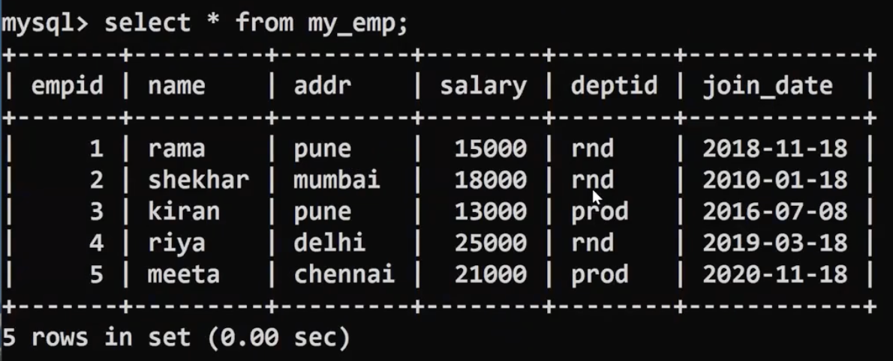
createStatement()

```java
package utils;
import java.sql.*;
public class DBUtils{
    //add a static method to return DB conncection instance
    //modify the code below, to ensure SINGLETON instance of the DB connection
    //(not a scalable solution, will be replaced by connection pool, from hibernate onwards)
    private static Connection cn;
    public static Connection openConnection() throws SQLException{
        if(cn==null){
        String url = "jdbc:mysql://localhost:3306/dac22?useSSL=false&allowPublicKeyRetrieval=true";
        //return DriverManager.getConnection(url,"root","root");
        cn = DriverManager.getConnection(url,"root","root");
        }
        return cn;
    }
}
```

```java
package tester;
import static utils.DBUtils.openConnection;
import java.sql.*;
public class TestStatement{
    public static void main(String[] args){
        try(Connection conn = openConnection();
            //create empty statement object, to hold query
            Statement st = conn.createStatement();
            ResultSet rst = st.executeQuery("select * from my_emp");)
        {
            while(rst.next())
                System.out.printf("Emp Id %d Name %s Address %s Salary %.1f DeptId %s Join Date %s %n", rst.getInt(1),rst.getString(2),rst.getString(3),rst.getDouble(4),rst.getString(5),rst.getDate(6));
        }//rst.close,st.close,cn.close-->autoclosability
        catch(Exception e){
            e.printStackTrace();
        }
    }
}
```

```java
package tester;
import java.util.Scanner;
import java.sql.*;
import static utils.DBUtils.openConnection;
public class TestPreparedStatement{
    public static void main(String[] args){
        String sql="select * from my_emp where deptid=? and join_date > ? order by salary";
        try(Scanner sc = new Scanner(System.in);
        //establish db connection
            Connection cn = openConnection();
            //create PST
            PreparedStatement pst = cn.preparedStatement(sql);
            ){
                System.out.println("Enter deptid n date");
                String deptId = sc.next();
                Date joinDate = Date.valueOf(sc.next());
                //set IN params
                pst.setString(1,deptId);
                pst.setDate(2,joinDate);
                //execute query
                try(ResultSet rst = pst.executeQuery()){
                    while(rst.next())
                        System.out.printf("Emp Id %d Name %s Address %s Salary %.1f DeptId %s Join Date %s %n", rst.getInt(1),rst.getString(2),rst.getString(3),rst.getDouble(4),rst.getString(5),rst.getDate(6));
                }//rst.close
            }//pst.close, cn.close
            catch(Exception e){
                e.printStackTrace();
            }
    }
}
```
# Day 1.2
Add Synchronized keyword again in both of the methods in JointAccount class n check if .. is removed
(refer to sequence n readme synchronization n synchro diagrams)

3. import day 21.3, to understand synchronized blocks
4. import day 21.4, for more practice on synchronization
5. Optional assignment:
refer to day 21-data\assignment
copy the package "thread_unsafe_collection", in your eclipse project
Run "ThreadUnsafeCollections.java", multiple times.
Do you see any problem?
You will see ConcurrentModificationException
Fix it.

Day 22
1.Complete earlier work
2.import day 22.1 in your core java workspace n revise, ITC n daemon threads 

Java EE
Day 1
1. import day1.1, in your newly created J2EE workspace
1.1 Fix build path
1.2 Edit DB username n password
1.3 Revise DBUtils n testing of statement n preparedStatement

2. Fresh assignment will be discussed later.
2. Refer to "topics-tutorials diagram"
2.1 Refer to "JavaEE\day1-data\day1_help\jdbc help\sql\topics-tutorials.txt"
Copy DDL n DML for: users, topics n tutorials table

Solve 
1. User login
I: email, password
O: User details in case of successful login or login failed messages

2. Change password
I: email, password, new password
O: A message indicating success or failure

3. Get all available topics
to be continued in day 5..
interface ResultSet 
02 Advanced Java- Learn with CDAC 1:36:18
cms - content management system
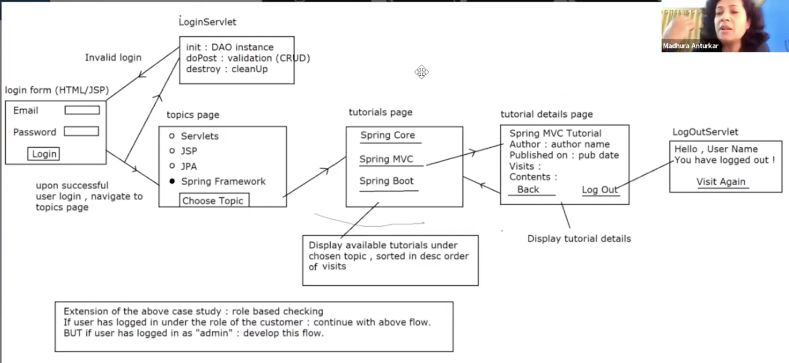

# 03 - Advance JAVA - Day 2.1 - JDBC Steps, and JDBC CRUD Application with Layered Architecture - CDAC

Today's topics
Revise ITC
revise JDBC steps
JDBC CRUD application with layered architecture
Java app --DAO interface & implementation class - DBUtils -- POJO -- DB
Stored procedure/function

ITC Help -> Inter Thread Communication [3:45]
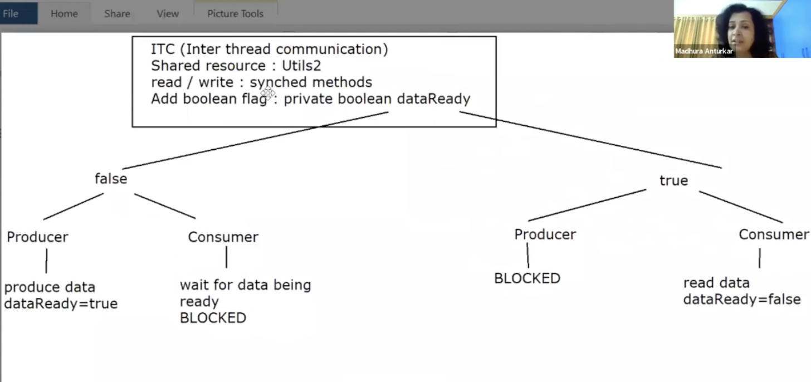

What is JDBC? : AN API to connect DB, CRUD apps, disconnect from DB
Which package? java.sql
why JDBC?: to Write platform independence n DB vendor independent apps(Partial)
How JDBC offers partial DB independence? :
1. JDBC Driver : connector (translator -- 2 way : java <---> DB)
2. JDBC API : java.sql --consists of largely interfaces : eg : connection, ST, PST, RST, CST .. : spacs 
Imple classes: JDBC JAR : provided by DB vendors or 3rd party vendors
eg: MySQL : mysql connector .jar

What is JDBC Driver? : connector
Types: (refer to slides)
Type IV JDBC Driver : pure java driver using vendor specific protocol
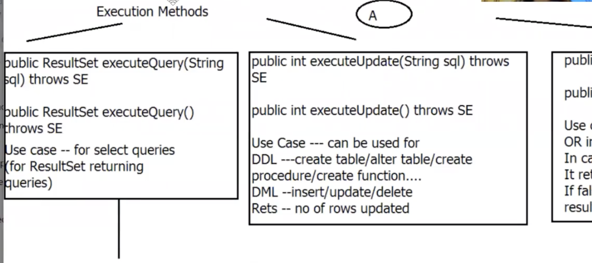

Objectives
1. User Login
sql : select * from users where email=? and password=?

Steps
0. Add JDBC driver in run time class path(i.e add ext.jar)
1. DBUtils : create singleton DB connection
1.1 load JDBC driver class in method area(optional)
class.forName("com.mysql.cj.jdbc.Driver");

1.2 get DB connection
Connection cn = DriverManager.getConnection("jdbc:mysql://localhost:3306/dac22?...",user,pwd);

2. create statement
3. set IN params
4. exec query
4. RST => in memory(heap) view (or object representation) of selected rows n cols
cursor : before 1st row
5. close DB resources: rst, st, cn : close

ORM - Object relational mapping
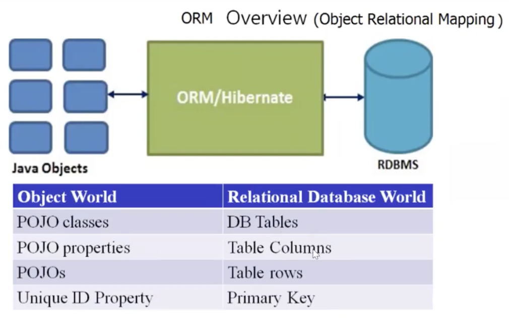
POJO - plain old java object-> represents DB entity doesn't have any business logic

Enter layered architecture
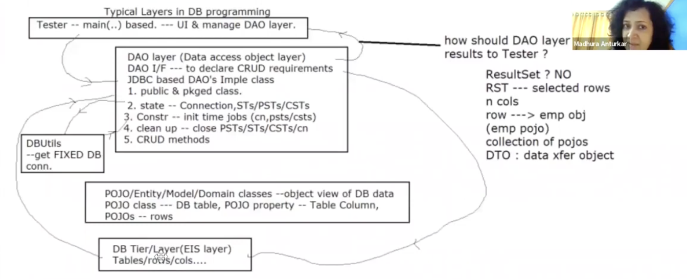

Solve below Objectives, using layers
Display details(id, name, salary, join date) of all emps from a specific dept, joined between start date n end date
sql : select id, name, salary, join_date from my_emp where deptid=? and join_date between ? and  ?

1. DB tier: my_emp table
2. POJO: Employee 
3. DAO
3.1 DAO interface : IEmployeeDao
1. add a method declaration for getting selected emps
List<Employee> getSelectedEmployeeDetails(String deptId, Date begin, Date end) throws SQLException


3.2 DAO imple class
1. state:
2. constr:
3. clean up:
4. CRUD methods

3. Insert emp details in the DB
3.1 no changes in db table
3.2 POJO : add required args ctor(all args except emp id)
3.3 DAO i/f :
String addEmpDetails(Employee e) throws SQLExc
3.4 DAO Imple. class

4. Update emp details
i/p emp id, new dept, sal incr
4.1 DB : no change
4.2 POJO : no change
4.3 DAO i/f 
String updateEmpDetails(emp id, new dept, sal incr) throws SQLExc
4.4 DAO impl class

5. Remove emp details
i/p emp id


refer earlier utils/DBUtils class
pojos/Employee.java
```java
package pojos;
//empid | name | addr | salary | deptid | join_date
public class Employee{
    private int empId;
    private String name;
    private String address;
    private double salary;
    private String deptId;
    private Date joinDate;
    //POJO specs : required in hibernate : def arg-less ctor
    public Employee(){
        //not reuired in JDBC, required in hibernate
    }
    public Employee(int empId, String name, double salary, Date joinDate){
        super();
        this.empId = empId;
        this.name = name;
        this.salary = salary;
        this.joinDate = joinDate;
    }

    public Employee(String name, String address, double salary, String deptId, Date joinDate){
        super();
        this.name = name;
        this.address = address;
        this.salary = salary;
        this.deptId = deptId;
        this.joinDate = joinDate;
    }//empId is auto incremented, no need here
        
    //getters n setters
    public int getEmpId(){
        return empId;
    }
    public void setEmpId(int empId){
        this.empId = empId;
    }
    public String getName(){
        return name;
    }
    public void setName(String name){
        this.name = name;
    }
    public String getAddress(){
        return address;
    }
    public void setAddress(String address){
        this.address = address;
    }
    public double getSalary(){
        return salary;
    }
    public void setSalary(double salary){
        this.salary = salary;
    }
    public String getDeptId(){
        return deptid;
    }
    public void setDeptId(String deptid){
        this.depid = deptid;
    }
    public Date getJoinDate(){
        return joinDate;
    }
    public void setJoinDate(){
        this.joinDate = joinDate;
    }
    //toString
    public String toString(){
        return "Employee [empId=" + empId + ", name=" + name + ", address=" + address + ", salary=" + salary + ", deptid=" + deptid + ", joinDate=" + joinDate + "]";
    }
}
```
dao/IEmployeeDao.java
```java
package dao;
import java.sql.*;
import java.sql.SQLException;
import java.util.List;
import pojos.Employee;
public interface IEmployeeDao{
    List<Employee> getSelectedEmpDetails(String dept, Date beginDate, Date endDate) throws SQLException;
    //add a method to insert new emp details
    String insertEmpDetails(Employee employee) throws SQLException;
    //add a method to update emp's dept n salary
    String updateEmpDetails(int empId, double salIncr, String newDept) throws SQLException;
    //add a method to delete emp details
    String deleteEmpDetails(int empId) throws SQLException;
    // add a method to get dept wise avg salary of the emps
    Map<String, Double> getAvgSalaryByDept() throws SQLException;
}
```
EmployeeDaoImpl
```java
package dao;
import java.sql.*;
import java.util.List;
import pojos.Employee;
import static utils.DBUtils.openConnection;
public class EmployeeDaoImpl implements IEmployeeDao{
    //state
    private Connection cn;
    private PreparedStatement pst1, pst2, pst3, pst4, pst5;

    public EmployeeDaoImpl() throws SQLException{
        //get fix db connection from DBUtils
        cn = openConnection();
        pst1=cn.preparedStatement("select empid, name, salary, join_date, from my_emp where deptid=? and join_date beween ? and ?");//column position as it appears in the result set to emp.add line
        pst2=cn.preparedStatement("insert into my_emp values(default,?,?,?,?,?)");
        pst3=cn.preparedStatement("update my_emp set salary=salary+?,deptid=? where empid=?");
        pst4=cn.preparedStatement("delete from my_emp where empid=?");
        pst5=cn.preparedStatement("select deptid, avg(salary) from my_emp group by deptid");
        System.out.println("emp dao created..");
    }
    @Override
    public List<Employee> getSelectedEmpDetails(String dept, Date beginDate, Date endDate) throws SQLException{
        List<Employee> emps = new ArrayList<>();
        //set IN params
        pst1.setString(1, dept);
        pst1.setDate(2, beginDate);
        pst1.setDate(3, endDate);
        try(ResultSet rst = pst1.executeQuery()){
            while(rst.next())
                emps.add(new Employee(rst.getInt(1), rst.getString(2), rst.getDouble(3), rst.getDate(4)));//column position as it appears in the result set from preparedstatement line
        }
        return emps;
    }

    @Override
    public String insertEmpDetails(Employee employee) throws SQLException{
        //set IN params
        //name | addr | salary | deptid | join_date
        pst2.setString(1,employee.getName());
        pst2.setString(2,employee.getAddress());
        pst2.setDouble(3,employee.getSalary());
        pst2.setString(4, employee.getDeptId());
        pst2.setDate(5,employee.getJoinDate());
        //exec the query : insert : DML : Method of PST : public int executeUpdate() throws SQLException
        int updateCount = pst2.executeUpdate();
        if(updateCount == 1)
            return "Emp details inserted..";
        return "Emp details insertion failed..";
    }

    @Override
    public String updateEmpDetails(int empId, double salIncr, String newDept) throws SQLException{
        //set IN params
        pst3.setDouble(1, salIncr);
        pst3.setString(2, newDept);
        pst3.setInt(3, empId);
        int updateCount = pst3.executeUpdate();
        if(updateCount == 1)
            return "Emp details updated..";
        return "Emp details updation failed..";
    }

    @Override
    public String deleteEmpDetails(int empId) throws SQLException{
        //set IN params : emp id
        pst4.setInt(1, empId);
        int updateCount=pst4.executeUpdate();
        if(updateCount==1)
            return "Emp details deleted..";
        return "Emp details deletion failed..";
    }

    @Override
    public Map<String, Double> getAvgSalaryByDept() throws SQLException{
        Map<String, Double> map = new LinkedHashMap<>();
        try(ResultSet rst = pst5.executeQuery()){
            while(rst.next())
                map.put(rst.getString(1), rst.getDouble(2));
        }
        return map;
    }
    //add a method to clean up db resources
    public void cleanUp() throws SQLException{
        if(pst1 != null)
            pst1.close();
        if(pst2 != null)
            pst2.close();
        if(pst3 != null)
            pst3.close();
        if(pst4 != null)
            pst4.close();
        if(pst5 != null)
            pst5.close();
        if(cn != null)
            cn.close();
        System.out.println("emp dao cleaned up!");
    }
}
```
DTO -> data transfer object

# 04 - Advance JAVA - Day 2.2 - Understanding Layered Architecture and DAO - Java By Madhura A - CDAC

```java
package tester;
import java.util.Scanner;
import dao.EmployeeDaoImpl;
public class TestEmpCRUD{
    public static void main(String[] args){
        try(Scanner sc = new Scanner(System.in)){
            //create emp dao instance: init phase of the app
            EmployeeDaoImpl dao = new EmployeeDaoImpl();
            boolean exit = false;
            while(!exit){
                System.out.println("1. Get Emp Details 2. Insert Emp details 3. Update Emp details 4. Delete Emp Details 5. Display avg sal by dept 10. Exit")
                try{
                    switch(sc.nextInt()){
                        case 1: //get emp details
                            System.out.println("Enter dept begin date n end date(yr-mon-day)");
                            List<Employee> empList = dao.getSelectedEmpDetails(sc.next(),Date.valueOf(sc.next()),Date.valueOf(sc.next()));
                            empList.forEach(System.out::println);
                        break;
                        case 2:
                            System.out.println("Enter emp details: name | addr | salary | deptid | join_date(yr-mon-day)");
                            System.out.println(dao.insertEmpDetails(new Employee(sc.next(),sc.next(),sc.nextDouble(),sc.next(),Date.valueOf(sc.next()))));
                            break;
                        case 3:
                            System.out.println("Enter empId, salIncr, newDept");
                            System.out.println(dao.updateEmpDetails(sc.nextInt(),sc.nextDouble(),sc.next()));
                            break;
                        case 4:
                            System.out.println("Enter emp id to remove emp details");
                            System.out.println(dao.deleteEmpDetails(sc.nextInt())); 
                            break;
                        case 5:
                            dao.getAvgSalaryByDept().forEach((dept,sal)-> System.out.println("Dept : " + dept + "Avg Sal" + sal));
                            break;
                        case 10:
                            exit = true;
                            // destroy(shut down) : clean up db resources
                            dao.cleanUp();
                            break;
                    }
                }
            }
        } catch(Exception e){
            e.printStackTrace();
        }
    }
}
```

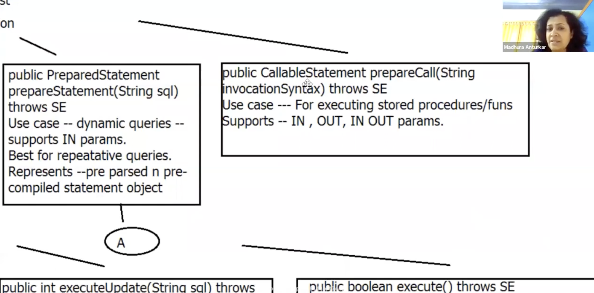
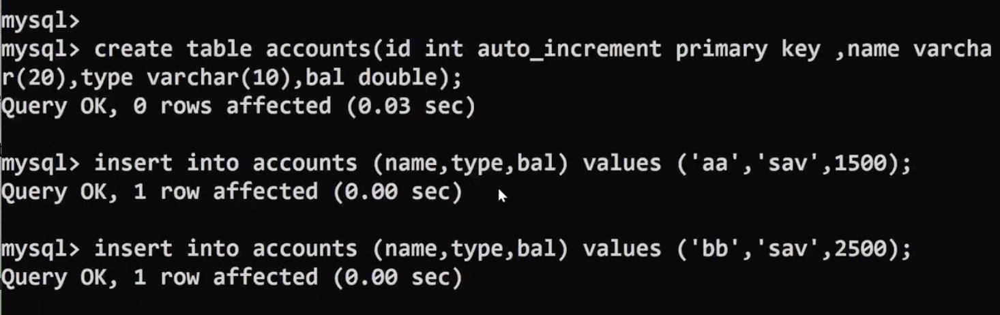
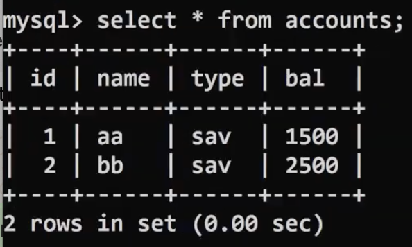

```text
#Stored procedure

drop procedure transfer_funds;

DELIMITER $$
create procedure transfer_funds(
    in sid int,
    in did int,
    in amt double,
    out sbal double,
    out dbal double
)
begin
update accounts set bal=bal-amt where id=sid;
update accounts set bal=bal+amt where id=did;
select bal into sbal from accounts where id=sid;
select bal into dbal from accounts where id=did;
end$$
 DELIMITER ;


DROP FUNCTION IF EXISTS F_TEST
DELIMITER $$
CREATE FUNCTION F_TEST(PID INT) RETURNS VARCHAR
BEGIN

DECLARE NAME_FOUND VARCHAR DEFAULT "";
```
sbal-> source balance
dbal->destination balance

```java
package pojos;
public class Account{
    //id | name | type | bal
    private int acctNo;
    private String customerName;
    private String acType;
    private double balance;
    //def ctor
    public Account(){

    }
    //getter n setters
    public String getAcctNo(){
        return acctNo;
    }
    public void setAcctNo(String acctNo){
        this.acctNo = acctNo;
    }
    public String getCustomerName(){
        return customeName;
    }
    public void setCustomerName(String customerName){
        this.customerName = customerName;
    }
    public String getAcType(){
        return acType;
    }
    public void setAcType(String acType){
        this.acType = acType;
    }
    public double getBalance(){
        return balance;
    }
    public void setBalance(double balance){
        this.balance = balance;
    }

    @Override
    public String toString(){
        return "Account [acctNo" + acctNo + ", customerName=" + customerName + ", acType=" + acType + ", balance=" + balance + "]";
    }
}
```

```java
package dao;
public interface IAccountDao {
    //add a method to transfer funds from src-->dest a/c
    String transferFunds(int srcAcctNo, int destAcctNo, double amount) throws SQLException;
}
```
```java
package dao;
import java.sql.SQLException;
public class AccountDaoImpl implements IAccountDao{
    private Connection cn;
    private CallableStatement cst1;

    public AccountDaoImpl(){
        //get db cn from DBUtils
        cn=openConnection(); 
        // cst1: to represent invocation of a stored proc
        cst1=cn.preparedCall("{call transfer_funds(?,?,?,?,?)}");
        cst1.registerOutParameter(4, Types.DOUBLE);
        cst1.registerOutParameter(5, Types.DOUBLE);
        System.out.println("acct dao created..");
    }
    @Override
    public String transferFunds(int srcAcctNo, int destAcctNo, double amount) throws SQLException{
        //set IN params
        cst1.setInt(1, srcAcctNo);
        cst1.setInt(2, destAcctNo);
        cst1.setDouble(3, amount);
        //exec stored procedure
        cst1.execute();
        return "Updated src Balance " + cst1.getDouble(4) + "Dest Balance " + cst1.getDouble(5);
    }
    public void cleanUp(){
        if(cst1 != null)
            cst1.close();
        if(cn != null)
            cn.close();
        System.out.println("acct dao closed...");
    }
}
```

Execute stored procedure : transfer funds
Steps
1. Stored proc/func exists in DB
2. Create CST from DB connection => pre-parsed, pre-compiled statement
API of Connection interface
public CST prepareCall(String sql) throws SQLExc.
sql : proc : "{call procName(?,?,?,?...)}"
sql : func : "{?=call funcName(?,?,?,?...)}"
3. Register OUT params => Informing JVM about JDBC data type of OUT param.
API of CST
public void registerOutParameter(int paramPos, int jdbcType) throws SQLException
4. IN : set it's value :
OUT :
IN OUT : 
5. Execute the proc/func
public boolean execute() throws SQLException
6. Retrieve the results stored in OUT param
API of CST
public Type getType(int paramIndex) throws SQLException
continue to web programing

```java
package tester;
import java.util.Scanner;
public class TestStoredProc{
    public static void main(String[] args){
        try(Scanner sc = new Scanner(System.in)){
            //create dao instance
            AccountDaoImpl dao = new AccountDaoImpl();
            System.out.println("Enter src dest a/c nos n amount");
            System.out.println(dao.transferFunds(sc.nextInt(),sc.nextInt(),sc.nextDouble()));
            dao.cleanUp();
        }catch(Exception e){
            e.printStackTrace();
        }
    }
}
```

# 05 - Advance JAVA - Day 2.3 - JDBC Types, Stored Procedures, and Tomcat Web Server - CDAC

Day 2
1. Revise JDBC CRUD app, by importing day 2.1 in your workspace
1.1 Fix build path
1.2 Edit DB username n password
## (29:00:00)
2. Fresh assignment, to complete data access logic of the Content Management System(topic-tutorials). MUST be done using layered architecture.

You can give it a try independently, otherwise, I will discuss it after I join.
Layers : Tester --DAO --DBUtils --POJO --DB

2.1 
User Login 
i/p : email, password
o/p : User details in case of successful login or login failed message
Steps
1. DB Layer : user (exists)
2. User POJO
2.1 properties : => cols : id | name | email | passoword | reg_amt | reg_date | role : java style names
2.2 def ctor
2.3 getters n setters
2.4 toString
3. DBUtils : copy from earlier
4. DAO : i/f 
4.1 User authenticateUser(String em, String pass) throws SE
5. JDBC based DAO imple class
5.1 state : cn pst1
5.2 def ctor : open cn(DBUtils), pst1
5.3 CRUD method 
User  authenticateUser(String em, String pass) throws SE
set IN params
execQuery --> RST --> process RST -- SUCCESS => return User pojo populated with DB data failure => null
5.4 clean Up : close pst n then cn
6. TestUserLogin
create dao instance, pass user credentials, invoke dao's method, clean up dao.

2.2 Display all available topics
DAO i/f
List<Topic> getAllAvailableTopics() throws SE

2.3 Display all available tutorial names, under selected topic, sorted as per visits , in desc order.
i/p : topic id
DAO i/f
List<String> getTutorialsByTopicId(int topicId) throws SE

2.4 Display selected tutorial details by name
1/p : tutorial name
ITutorialDAO i/f 
Tutorial getTutorialDetailsByName(String tutName) throws SE

2.5 Update visits
i/p : tutorial id
ITutorialDao i/f 
String updateVisits(int tutorialId) throws SE
 
3. Steps will be discussed.
Add a web server to the workspace. Test it, Deploy a simple web app n test HTML content.

4. Discuss reading H.W

## (1:25:00) tomcat steps readme
